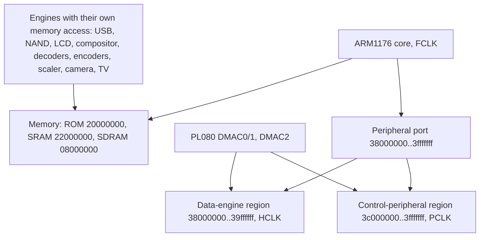

# Physical address map and buses

Every physical address the firmware images use, grouped by bus region, with
interrupt line, clock gate and DMA endpoint where known. Register details are
on each block's page; this page is the index by address.

The firmware does not name buses next to peripherals. What it shows is the
CPU's peripheral-port window, four bus clocks, and which clock individual
drivers compute their timing from. The AHB/APB assignment below rests on that,
plus the split of the address space into two regions; rows without driver
evidence are marked inferred.

## Bus structure

| Element | Evidence | Type |
|---|---|---|
| Peripheral-port remap `0x38000012` (CP15 `c15,c2,4`): base `0x38000000`, size field `0x12` = 128 MiB, so `0x38000000..0x3fffffff` | written by the ROM and SecCore ([CPU/memory](cpu-memory.md)); range from the ARM1176 field encoding | observed value; range decoded |
| MMU maps `0x38000000..0x3fffffff` identity with peripheral attributes | bootloader page tables ([CPU/memory](cpu-memory.md)) | observed |
| Four bus/core clocks: the iPod OS prints SCLK, FCLK, ACLK, HCLK, PCLK, AMCCLK from its rate getter, ids 0, 1, 2, 3, 4, 6 | `osos mem:0x0813467c` calling `mem:0x22002c66` | observed |
| Boot ROM rates: FCLK 216 MHz, HCLK 108 MHz, PCLK 54 MHz | `bootrom mem:0x20001b10` stores them at state `+0x51c/+0x520/+0x524` | observed constants |
| Bootloader rates: CLKCON1 `0x00404040` gives HCLK = PCLK = ACLK = FCLK/2, about 137 MHz | [clocks/reset](clocks-reset.md) | observed; rates nominal |

The bootloader clock service uses different ids from the iPod OS: hclk 2,
pclk 4, aclk `0x13` ([clocks/reset](clocks-reset.md)). ACLK is a fourth bus
clock with its own CLKCON1 divider field; no driver was found deriving timing
from it.

### Which clock drivers use

| Block | Clock read | Use | Evidence |
|---|---|---|---|
| SPI0, SPI1, SPI2 | PCLK (state `+0x524`) | `+0x30` divider = PCLK / target rate | `bootrom mem:0x20005304`, callers `0x20008bf4/0x20008c3c/0x20008c78` |
| Timer block `0x3c700000` | PCLK | timeout scaling of the system counter `+0x84` | `bootrom mem:0x20003384`, `0x20003438` |
| NAND controller | HCLK (clock service id 2) | FMC setup/hold/EDO clock counts | `bootloader NandReadOnly.pe+0x23cc` (slot `+0x18`, id 2), used by `FIL_CalcTiming` `+0x542c`; `disk mem:0x080338c0` |
| USB OTG | PCLK value passed in the boot context | not traced further; not bus evidence | `bootrom mem:0x200035e4` |
| CPU delay loops | FCLK | busy-wait iteration count | `bootrom mem:0x20000980` |

## Data-engine region `0x38000000..0x39ffffff`

Blocks that move bulk data: DMA controllers, memory-access engines and their
interrupt controller. One block per 1 MiB step except where noted. Inferred AHB
(HCLK); the NAND controller is the driver-confirmed HCLK row.

| Base | Block | IRQ | Gate (disk id) | DMA endpoint | Page |
|---|---|---:|---|---|---|
| `38000000` | SHA engine | | 16 | | [sha](sha.md) |
| `38100000` | bus-fabric word `+0x8c` | | | | [bus fabric](bus-fabric.md) |
| `38200000` | PL080 DMAC0 | 16 | 5 | | [dma](dma.md) |
| `38300000` | LCD controller | | 15 | DMAC0 req 3 (`+0x40` write FIFO) | [lcd-controller](lcd-controller.md) |
| `38400000` | USB OTG controller | 19 | 14 | own DMA | [usb-controller](usb-controller.md) |
| `38501000` | unknown word (written 2 in PreEfi) | | | | [bus fabric](bus-fabric.md) |
| `38700000` | PL080 DMAC1 | 17 | 4 | | [dma](dma.md) |
| `38800000` | DMAC2 | 29 | | | [dma2](dma2.md) |
| `38900000` | CLCD display compositor | 14 | | own memory access | [display-compositor](display-compositor.md) |
| `38a00000` | NAND controller (FMC/FMSS); ECC at `+0x800` | 54 | 11 (FMC), 7 (ECC) | DMAC1 req 0 (`+0x80` FIFO) | [nand-fmss](nand-fmss.md), [ecc](ecc.md) |
| `38c00000` | AES | | 9 | | [aes](aes.md) |
| `38e00000` | VIC0 | | | | [interrupts](interrupts.md) |
| `38e01000` | VIC1 (4 KiB above VIC0); source-side clears `38e02008/0c` | | | | [interrupts](interrupts.md) |
| `38f00000` | H.264 decoder | 35 | | own memory access | [video-decoder](video-decoder.md) |
| `39000000` | scaler / colour converter (started from the camera IRQ 57 handler) | | | own memory access | [scaler](scaler.md) |
| `39100000` | TV video scaler | | | own memory access | [tv-scaler](tv-scaler.md) |
| `39200000` | TV mixer | | | own memory access | [tv-mixer](tv-mixer.md) |
| `39300000` | TV output encoder | | | | [tv-encoder](tv-encoder.md) |
| `39600000` | MPEG-4 Part 2 / H.263 / JPEG decoder | 45 | iPod OS clock id `0x40` | own memory access | [video-decoder](video-decoder.md#mpeg-4-part-2-h263-and-jpeg-decoder-0x39600000) |
| `39700000` | GPIO interrupt controller | GPIO groups 0..6 on 33, 32, 31, 3, 2, 1, 0 | | | [interrupts](interrupts.md) |
| `39800000` | JPEG encoder | 56 | | own memory access | [jpeg-encoder](jpeg-encoder.md) |
| `39900000`, `39a00000` | camera capture interface | 57 | | own memory access | [camera-interface](camera-interface.md) |

## Control-peripheral region `0x3c000000..0x3fffffff`

Register-programmed controllers, FIFO endpoints for the PL080s and system
control. Inferred APB (PCLK); SPI and the timer block are the driver-confirmed
PCLK rows. Three blocks here are not simple slaves: the SDRAM controller, the
video encoder (it fetches its program and data itself) and the PKA (private
operand RAM).

| Base | Block | IRQ | Gate (disk id) | DMA endpoint | Page |
|---|---|---:|---|---|---|
| `3c100000` | random-number block | | 51 | | [prng](prng.md) |
| `3c200000` | click wheel controller | 23 | 50 | | [clickwheel](clickwheel.md) |
| `3c300000` | SPI0 | | | DMAC1 req 10/11 | [spi-nor](spi-nor.md) |
| `3c400000` | USB PHY | 50 | 49 | | [usb-phy](usb-phy.md) |
| `3c500000` | clock and reset controller | | | | [clocks-reset](clocks-reset.md) |
| `3c600000` | I2C0 | 21 | 48 | | [i2c](i2c.md) |
| `3c700000` | timers 0..7, system counter `+0x84`; PWM uses timer 0 | 7 (timer 5), 8 | | | [timers-watchdog](timers-watchdog.md) |
| `3c800000` | watchdog | | | | [timers-watchdog](timers-watchdog.md) |
| `3c900000` | I2C1 | 22 | 47 | | [i2c](i2c.md) |
| `3ca00000` | I2S0 (in the base table, unused) | | | DMAC0 req 10/11 | [audio-i2s](audio-i2s.md) |
| `3cc00000` | UART0 | | 21 | DMAC0 req 6/7 | [uart](uart.md) |
| `3cd00000` | I2S1 (FM radio receive) | | | DMAC1 req 2/3 | [audio-i2s](audio-i2s.md), [fm-radio](fm-radio.md) |
| `3ce00000` | SPI1 | | | DMAC0 req 14/15 | [spi-nor](spi-nor.md) |
| `3cf00000` | GPIO and pin mux; mux command `+0x240`; memory pad controls `+0x380/+0x384` | | 37 | | [gpio-pinmux](gpio-pinmux.md) |
| `3d000000` | public-key accelerator, operand RAM at `+0x800` | | 36 | | [pka](pka.md) |
| `3d100000` | chip ID | | 35 | | [chipid](chipid.md) |
| `3d200000` | SPI2 | | | DMAC0 req 12/13 | [spi-nor](spi-nor.md) |
| `3d400000` | I2S2 (codec) | | | DMAC0 req 0/1, DMAC1 req 4/5 | [audio-i2s](audio-i2s.md) |
| `3d500000` | memory-system word `+0x400` (written 7) | | | | [bus fabric](bus-fabric.md) |
| `3d700000` | SDRAM controller | | | | [sdram](sdram.md) |
| `3da00000` | SPI3 | | | | [spi-nor](spi-nor.md) |
| `3db00000` | UART1 | | 20 | DMAC0 req 8/9 | [uart](uart.md) |
| `3dc00000` | UART2 | | 19 | DMAC1 req 8/9 | [uart](uart.md) |
| `3dd00000` | UART3 | | 18 | DMAC1 req 12/13 | [uart](uart.md) |
| `3de00000` | single-wire interface (PMU / backlight) | 52 | 52 | | [backlight](backlight.md) |
| `3e000000` | memory-system words `+0x08` (written `1f`), `+0x0c` (bits 1:0) | | | | [bus fabric](bus-fabric.md) |
| `3e100000` | SPI4 | | | | [spi-nor](spi-nor.md) |
| `3e400000` | video encoder | 59 | | own memory access | [video-encoder](video-encoder.md) |
| `3e500000` | fifth UART endpoint | | | DMAC0 req 4/5 | [uart](uart.md) |
| `3ff00000` | bus-fabric controller: start-up words `+0x100/+0x104/+0x220/+0x77c` | | | | [bus fabric](bus-fabric.md) |

DMA request numbers come from the DmaLight routing table; the TX/RX data
register offsets are on the [DMA page](dma.md). The I2S endpoints are
`+0x10` (TX) and `+0x38` (RX), UARTs `+0x20/+0x24`, SPI `+0x10/+0x20`.

`0x3c710000` reads 0. Addresses not listed here have not been seen in any
image; a gap is not proof that nothing is decoded there.

## Memory

| Range | Contents | Page |
|---|---|---|
| `08000000..0bffffff` | SDRAM, 64 MiB | [CPU/memory](cpu-memory.md), [sdram](sdram.md) |
| `20000000..2000ffff` | mask ROM, 64 KiB | [CPU/memory](cpu-memory.md) |
| `22000000..2206ffff` | SRAM, 448 KiB | [CPU/memory](cpu-memory.md) |
| `88000000..8bffffff` | uncached SDRAM alias (page tables, not hardware) | [CPU/memory](cpu-memory.md) |

## Unknown

The bus each block sits on, apart from the driver-confirmed rows; whether ACLK
clocks an AXI segment and which blocks it serves; the arbitration and
bridge structure behind the bus-fabric words; whether the data engines reach
SDRAM through one port or several; and the IRQ lines of the blocks left blank.

## Finding ledger

| Finding | Evidence | Type |
|---|---|---|
| Peripheral port covers `0x38000000..0x3fffffff` | CP15 value `0x38000012`, ROM and SecCore | observed value; range from the register encoding |
| iPod OS clock names SCLK/FCLK/ACLK/HCLK/PCLK/AMCCLK = getter ids 0/1/2/3/4/6 | `osos mem:0x0813467c` | observed |
| SPI0/1/2 dividers computed from PCLK | `bootrom mem:0x20005304` | observed |
| Timer-block timeouts scaled by PCLK | `bootrom mem:0x20003384`, `0x20003438` | observed |
| NAND controller timing computed from HCLK (clock service id 2) | `bootloader NandReadOnly.pe+0x23cc`, `+0x542c` | observed |
| Data-engine region = AHB, control-peripheral region = APB | address split plus the rows above | inferred |
| No firmware string or table names a bus for a peripheral | string search of osos, disk, bootloader ClockAndReset and NandReadOnly, diag TestClock | bounded negative search |
| Base, IRQ, gate and DMA columns | the linked block pages | as cited there |
