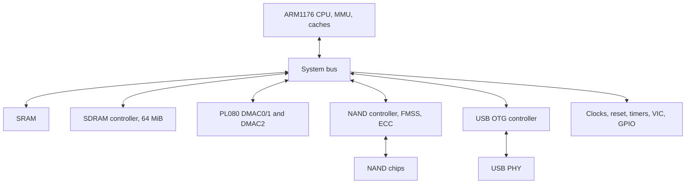
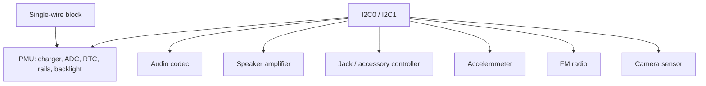
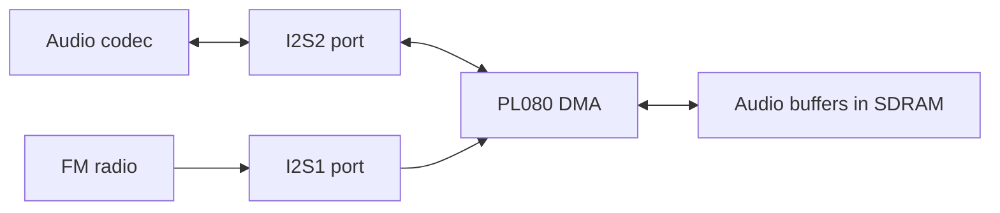
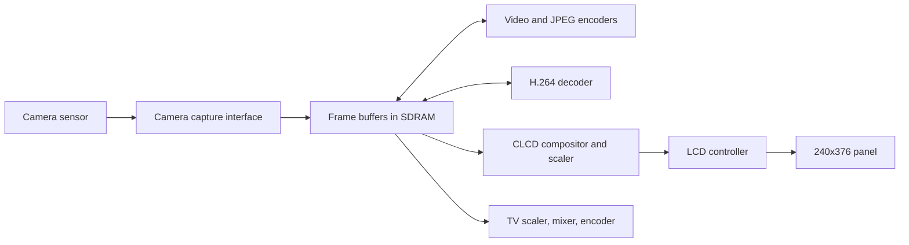

# iPod nano 5G hardware overview

Programming reference for the S5L8730-based iPod nano 5G, recovered from the
mask ROM, the N33 bootloader, the restore/disk OS, the iPod OS (osos) and the
diagnostics image. Register and signal meanings come from how the firmware
uses them; values the firmware uses without revealing their meaning are listed
as unknown. Reserved registers, board traces and electrical limits are not
covered. A block that only the diagnostics image touches, or that only appears
in a clock table, is not necessarily populated on every board revision.

## System connections

Processor, memory, storage and USB:

Control buses (the CPU drives the controllers in the top row; the click wheel
has its own serial controller and is not on I2C):

Audio data path (the codec drives the headphone output and the speaker
amplifier):

Imaging and display:

The arrows are data-flow relationships seen in the firmware, not pin
connections. Where a path stores intermediate buffers in RAM the pages say so.

## Processor, memory and control blocks

| Hardware / reference | Address or interface | Recovered scope |
|---|---|---|
| [CPU, caches, MMU and memory](cpu-memory.md) | ROM 20000000; SRAM 22000000; SDRAM 08000000 | ARM/Thumb, CP15 operations, mappings, aliases, handoff |
| [SDRAM controller](sdram.md) |3d700000; pad controls 3cf00380/384| Cold/warm commands, DLL poll, timing words; field units partly unknown |
| [Clock/reset controller](clocks-reset.md) |3c500000| PLL and gate operations, all 74 disk gate-table rows |
| [Bus-fabric controls](bus-fabric.md) |38100000,38501000,3d500400,3e000008,3ff00000| Exact known writes/polls; IP names mostly provisional |
| [Interrupt controllers](interrupts.md) |38e00000/38e01000; GPIO-IRQ 39700000| Enable, vector, acknowledge and peripheral/group mappings |
| [Timers/watchdog](timers-watchdog.md) |3c700000;3c800000| Count/prescale/IRQ layout, firmware timer variants, reset sequence |
| [GPIO/pinmux](gpio-pinmux.md) |3cf00000; command 3cf00240|18 ports, mux command,54 early words, known board signals |
| [I2C](i2c.md) |3c600000/3c900000| Init, byte handshake, ACK/IRQ handling and bus-device addressing |
| [PL080 DMA](dma.md) |38200000/38700000| Channels, LLIs, fields, request routing and original tables |
| [Separate DMAC2](dma2.md) |38800000| Four-channel ROM/restore engine; PL080-style global map, different channel control word |
| [Chip ID](chipid.md) |3d100000| Validity and variant fields; no fuse-programming claim |
| [Random-number block](prng.md) |3c100000| Prepare, status poll, result read, gate restoration |

All unprefixed addresses in these tables are **hexadecimal**. A base identifies
only the observed block; a range between bases is not automatically mapped RAM.
SDRAM is 64 MiB as reported by the firmware. SRAM: the boot ROM uses 192 KiB, the
iPod OS 320 KiB, the bootloader declares 448 KiB (evidence in the CPU and memory page).

## Storage and data engines

| Hardware / reference | Address / interface | Recovered scope |
|---|---|---|
| [NAND controller and FMSS](nand-fmss.md) |38a00000| Commands, sequencer RAM, DMA/descriptor ABI, IRQ/status, write/read/erase |
| [NAND chips](nand-chips.md) |Up to 8 controller chip selects|18 original geometry rows, IDs, page/spare/block sizes, timing parameters |
| [ECC](ecc.md) |FMC+800| Data/spare correction paths, parity placement, completion/status distinctions |
| [AES](aes.md) |38c00000| Raw block interface, key/IV selectors, DMA, reset/status |
| [SHA interface](sha.md) |38000000| Command word, register-window and DMA paths, padding and byte order |
| [Public-key accelerator](pka.md) |3d000000| Command/geometry/flag registers, operand RAM slots, two-source multiply, interrupt |
| [SPI controllers / serial NOR](spi-nor.md) |3c300000,3ce00000,3d200000,3da00000,3e100000| ROM read/status/ID path; physical NOR population unconfirmed |

The FTL, VFL, filesystems, container formats and codec parsers are software
layers. They help explain use of hardware but are not additional silicon
register blocks.

## USB, power and user inputs

| Hardware / reference | Address / interface | Recovered scope |
|---|---|---|
| [USB controller](usb-controller.md) |38400000, IRQ 19| Core/device/endpoint map, DMA ownership and event handling |
| [USB PHY](usb-phy.md) |3c400000, IRQ 50| Power, reset, tuning literals, stage-specific delays and line inputs |
| [PMU / charger](pmu.md) |I2C0,7-bit 73| Power/charge/status/events, exact early writes including unknown rail fields |
| [ADC](adc.md) |PMU 40..42,44| Battery channel, sample assembly, OSOS conversion and thresholds |
| [RTC](rtc.md) |PMU 50..5a| Exact time/alarm transfers; calendar-field semantics partly unresolved |
| [Backlight](backlight.md) |PMU 30/31; serial interface 3de00000| Brightness/control and serial commands |
| [Clickwheel](clickwheel.md) |3c200000, IRQ 23| TX/RX packets, touch/position/buttons, hold/interrupt recovery |
| [Accelerometer](accelerometer.md) |I2C0; diagnostic 09 and recovery 19| Register reads/writes, range/power, axes, scaling and interrupt test |
| [UARTs](uart.md) |3cc00000,3db00000,3dc00000,3dd00000; fifth endpoint 3e500000| Four-controller init/TX and fifth DMA endpoint evidence |

PMU hold input, USB session-valid, line-state classification, charging-busy
and battery voltage are different signals. In particular, USB connected does
not mean charging; zero charging-busy bits mean complete only in the appropriate
enabled/settled path. See PMU for the exact predicates and unresolved fault paths.

## Audio, imaging and display

| Hardware / reference | Address / interface | Recovered scope |
|---|---|---|
| [I2S](audio-i2s.md) |Codec I2S2=3d400000; radio I2S1=3cd00000| TX/RX FIFOs, clocks, sample formats and DMA requests |
| [Audio codec](audio-codec.md) |I2C0,7-bit 4a| Register startup, routes, volume, playback and recording |
| [Speaker amplifier](speaker-amplifier.md) |I2C0/1,7-bit 6f| Command-only protocol, gains, mute/shutdown; board revision selects bus |
| [Headphone/accessory controller](headphone-interface.md) |I2C0/1,7-bit 39| Jack detection and idle masks; accessory protocol partial |
| [FM radio](fm-radio.md) |I2C0,7-bit 63; I2S1 RX| Ready/status, command packets, clock/property sequence, raw unknown commands |
| [Camera sensor variants](camera-sensors.md) |I2C0,7-bit 3c|7692/7739 ID/framing, power/probe and 240 ordered register writes |
| [Camera capture interface](camera-interface.md) |39900000/39a00000, IRQ 57| Capture buffer geometry, interrupts, preview and shutdown |
| [Video encoder](video-encoder.md) |3e400000| Program/configuration, command/data flow, IRQ and firmware dependency |
| [H.264 decoder](video-decoder.md) |38f00000| NAL/picture paths, reset, addresses, status/IRQ, decoded-frame handling |
| [JPEG encoder](jpeg-encoder.md) |39800000, IRQ 56| Quantization/Huffman/configuration, input/output and completion |
| [Display compositor/scaler](display-compositor.md) |38900000| YUV/RGB composition, scaling, coefficient tables and transfer ownership |
| [Scaler / colour converter](scaler.md) |39000000| Source/destination planes, ratios, polyphase banks, colour matrix |
| [LCD controller](lcd-controller.md) |38300000| Panel command/read/write and framebuffer transfer |
| [LCD panels](lcd-panels.md) |Panel-command bus| IDs, geometry, orientation, init/sleep/wake command scripts |
| [TV pipeline](tvout.md) |Three banks below| Recovered diagnostic data path and ordered lifecycle |
| [TV video/scaler](tv-scaler.md) |39100000| Input planes, dimensions/ratios, coefficients and unknown controls |
| [TV mixer](tv-mixer.md) |39200000| Graphics/video plane controls, buffers, position and raw blend fields |
| [TV output encoder](tv-encoder.md) |39300000| Timing/level words, update/stop handshake, undecoded analog controls |

Each page's register table is the authority; the names in this overview only
summarize what the block is used for.

## Evidence classes

- **observed**: an instruction or literal in a named image, cited by address.
- **dynamic analysis**: original code executed under emulation (simulation of a
  named image) and its outputs captured.
- **device**: a measurement or log from a physical unit.
- **inferred**: a role deduced from usage, not decoded independently.
- **unknown**: an address, value or mask the firmware uses without revealing
  its meaning.

Conventions: R/W marks registers that are both read and written; W1C registers
are acknowledged by writing a 1 to the bit. Read-modify-write masks, repeated
writes, sequence order, the clock-gate numbering of the image in question and
delay units are stated as the firmware uses them; a loop count is a count, not
a time. MMIO addresses, firmware RAM structures, PE offsets and image file
offsets are different coordinate systems and are labelled as such.

[Open questions](unknowns.md) lists what is still unknown per block.
