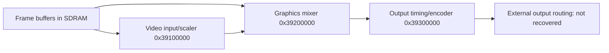

# TV-output pipeline

The diagnostic firmware programs three MMIO banks in sequence:

The arrows are inferred from buffer, dimension and lifecycle code. Per-bank references:

- [Video input and scaler](tv-scaler.md)
- [Graphics mixer](tv-mixer.md)
- [Output timing and encoder](tv-encoder.md)

All three use 32-bit registers. The source is `diag Tvout.pe`: 51 defined
functions, covering code and nearby data up to
offset 0x6000 of the module (large data records are not covered).

## Control sequence

Enable path, `diag Tvout.pe+0x0f04`:

1. Request clocks.
2. Delay (service argument 50).
3. Clear output control `00`; clear mixer/video enable bits.
4. Delay again.
5. Initialize the video bank (`diag Tvout.pe+0x12dc`, writes to 39100000 only).
6. Initialize the mixer bank (`diag Tvout.pe+0x1098`, writes to 39200000 only).

`diag Tvout.pe+0x0ec8` calls that preparation, then:

1. `diag Tvout.pe+0x0b84`: programs the output-timing tables (`diag Tvout.pe+0x11ec` or 0x10f4 by mode).
2. `diag Tvout.pe+0x0adc`: enables the banks through 0x0be8.
3. Writes output `284=0`.

Disable path:

1. Write output `280=1`; set `284` bit 0; clear output `3c` low 4 bits.
2. Clear enable bit 0 and wait for status bit 1, in the order output 39300000, mixer 39200000, video 39100000. Each loop is bounded at 10 iterations; failure returns -1.
3. Clock release (`diag Tvout.pe+0x1008`) follows successful stops and covers only selector 0x47.

Durations in microseconds are not known.

## Coverage

The three register pages list **398 direct absolute-MMIO assignments** from the
defined functions, including repeats and conditional alternatives, with raw
coefficient/level/control values. Indirect pointer writes and unrecognized
functions are not covered; conditions, ordering across helpers and read side
effects need the source listing.

Not known: connector pinout, DAC levels, region/timing-enum names, cable
detection, interrupt mapping, picture quality, and normal-OSOS use. Whether
every output mode ships or works on every board is not established.

## Finding ledger

| Finding | Evidence | Type |
|---|---|---|
| Three banks and their stop order | `diag Tvout.pe+0x0f04` | observed |
| Buffer/scale/mix relationship | `diag Tvout.pe+0x09a8`, `+0x0a54`, `+0x0d1c` and helpers | inferred (arithmetic and writes) |
| Raw register values | direct-write extraction of the 51 functions | observed; direct assignments in 51 functions only |
